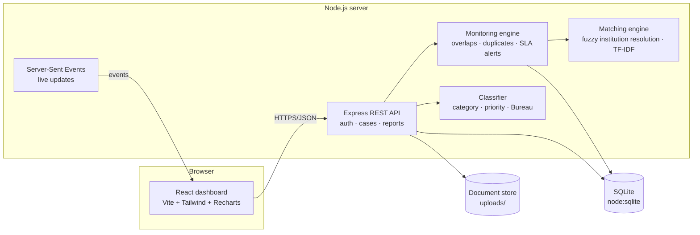

# AICTE ICMS — Integrated Complaint Monitoring Dashboard

**Smart India Hackathon 2026 · Problem Statement SIH26264 · AICTE / Regulation Bureau · Theme: Smart Automation**

A single-window dashboard where authorised AICTE officials see every institution-related complaint across the Regulation Bureau (RB), the Public Grievance Redressal Cell (PGRC), other Bureaus/Cells and Regional Offices. It tracks each case through its lifecycle and **automatically detects when the same institution is being handled by more than one Bureau/Cell**, even when complainants spell the institution differently or quote no AICTE ID. When that happens it raises **"Potential Overlapping Cases – Coordination Required"**.

The full problem statement is in [docs/PROBLEM_STATEMENT.md](docs/PROBLEM_STATEMENT.md). How each requirement is met is in [docs/REQUIREMENTS_MAP.md](docs/REQUIREMENTS_MAP.md).

### Live demo: **https://shash1704.github.io/aicte-icms/**

Click any demo account on the sign-in screen (password `Aicte@2026`). The demo is a static GitHub Pages site: the **same server code runs inside your browser** (SQLite compiled to WebAssembly via sql.js, plus a small Express-compatible router), so it needs no backend. The first visit takes a few seconds to generate the demo data; your changes are saved in your own browser only, and *Administration → Reset demo data* starts over. Live updates are per browser tab in this mode. The full multi-user server is described below. See [How the browser demo works](#how-the-browser-demo-works).

> **All data is synthetic.** No dataset came with the problem statement, so the app generates fictional institutions, officials and complaints (see [Demo data](#demo-data)).

---

## Quick start

Needs **Node.js 22.13 or newer** (it uses Node's built-in SQLite, so there is no database to install).

```bash
npm run setup
```

```bash
npm run build && npm start
```

Open **http://localhost:4000**. The first start creates the demo database automatically (about 1 second).

For development (API with auto-reload on :4000, Vite on :5173):

```bash
npm run dev
```

Other commands: `npm run seed` resets the demo data · `npm test` runs the test suite (18 tests).

### Demo accounts

Password for every account: **`Aicte@2026`**. The login screen also lists them, one click each.

| Username | Role | Sees / can do |
|---|---|---|
| `chairman`, `ms` | Competent Authority (admin) | Everything; issues directions on escalated cases; demo feed and audit trail |
| `rb.head`, `pgrc.head`, `ab.head`, `arc.head`, `fb.head`, `papb.head` | Bureau/Cell Head | All cases; acts on and reassigns its Bureau's cases; coordinates overlaps |
| `rb.officer1`…`4`, `pgrc.officer1`…`4`, `ab.officer1`, `arc.officer1`, … | Case Officer | All cases (for awareness); acts only on its Bureau's cases; coordination notes elsewhere |
| `ro.nro`, `ro.nwro`, `ro.wro`, `ro.cro`, `ro.ero`, `ro.sro`, `ro.swro`, `ro.scro` | Regional Officer | Only its region; acts on cases transferred to the Regional Office |

---

## What it does

| Problem-statement feature | Where |
|---|---|
| 1. Centralised institution profile (AICTE Permanent ID, address, region, history) | **Institutions → profile**, including a cross-Bureau timeline that shows parallel handling at a glance |
| 2. Case tracking (ID, receipt date, category, status, Bureau, officer, last/next action, dates) | **Cases** register and **case page** |
| 3. Cross-Bureau overlap detection, alerts, linking | **Overlaps & duplicates**; banner on every affected case; alerts; intake pre-check |
| 4. Real-time dashboard (received, pending, under process, disposed, transferred, beyond timeline, institution-wise, Bureau-wise workload) | **Dashboard**, updated live over Server-Sent Events |
| 5. Workflow and action history (who, when, remarks, documents, transfers, escalations) | **Case page → Workflow & action history** |
| 6. Search and filters (institution, AICTE ID, Case ID, Bureau, region, category, status, date range) | **Cases** filters, plus a global fuzzy search box in the header |
| 7. Alerts (overlap/duplicate, pending reminders, escalation, timeline/SLA) | **Alerts** page and header bell |
| 8. Reports (Bureau-, region-, institution-wise; ageing; disposal rate; overlaps; monthly/quarterly) | **Reports** — 10 reports, CSV export, print to PDF |

### The innovation: finding the same institution behind different references

Complaints rarely quote a clean AICTE ID. The matching engine ([server/src/matching.js](server/src/matching.js)) resolves free text such as *"Aryabhata Engg Clg, Nagpur"*, *"AIET"* or a mistyped ID to the institution master:

1. **AICTE ID normalisation** — `1-123…`, `1 123…`, `1123…` all match; near-miss IDs get partial credit.
2. **Abbreviation expansion** — Engg → engineering, Inst./Instt → institute, Clg → college, Tech → technology, and more.
3. **IDF-weighted soft token matching** — distinctive words ("Aryabhatta") count more than common ones ("Institute"). Jaro-Winkler similarity tolerates misspellings (Aryabhata ≈ Aryabhatta).
4. **Acronyms** — "AIET" or "AIETN" ↔ *Aryabhatta Institute of Engineering & Technology, Nagpur*.
5. **Former names** — aliases stored on the institution profile match as well.
6. **Location cues** — the city decides between institutions with the same name in different cities.
7. **Confidence bands** — a score of 85% or more with a clear margin links automatically; 55–85% goes to an officer to confirm (*Overlaps → Identify institution*); below that the case stays unresolved.

On the seeded data the matcher automatically links about 650 messy references with **no wrong links**, and sends about a dozen genuinely ambiguous ones to an officer (the seed script measures this on every run). Without a city or ID to confirm it, a second strong candidate always means a human decides.

Once institutions are resolved, the overlap engine ([server/src/engine.js](server/src/engine.js)):

- Groups **active** cases by institution and flags any institution with cases in **two or more Bureaus/Cells**.
- Rates severity: **critical** when RB and PGRC are both acting on the same issue; **serious** when both are involved or the texts match; **warning** otherwise.
- Explains itself in plain language, for example: *"AICTE/PGRC/2026/00103 and AICTE/RB/2026/00041 are 31% similar in content (₹1,35,000, refund, fee)"*, *"Same complainant in …"*, *"linked by name matching even though no AICTE ID was quoted"*.
- Detects **likely duplicates** with TF-IDF text similarity. Words from the institution's own name are removed first, and rupee amounts are kept as strong evidence. Same complainant email or phone is also checked.
- Supports a **coordination workflow**: *Acknowledge → Designate lead Bureau → (cases auto-linked, coordination note written to every case history)*, or *Not related*. If a new case joins later, the overlap reopens.

At intake, a rule-based classifier ([server/src/classifier.js](server/src/classifier.js)) suggests the category, priority and handling Bureau/Cell, and shows the keywords that triggered each suggestion. It also warns when a complaint raises both grievance and regulatory issues, so RB and PGRC are both likely to act. Before registering, the officer sees existing cases, overlaps and possible duplicates for that institution.

Every decision is **deterministic and explainable**: no external AI service, no data leaving the server. That matters for a government system, where officials must justify why cases were linked.

### Other automation

- **Prescribed timelines (SLA)** per category, for example Ragging 7 days, Certificates 15, Fee refund 30, Faculty norms 60. Expected disposal date is computed automatically.
- **Alert engine**, idempotent and re-run every minute. It raises: timeline approaching (7 days) / crossed; no action for 15 days; transferred but not accepted in 3 days; overdue 30+ days, escalation recommended; overlap; duplicate; institution not identified. Alerts **resolve themselves** when the condition clears.
- **Auto-assignment** to the least-loaded officer of the receiving Bureau, or to the region's officer for Regional Office cases.
- **Live updates**: every action is pushed to all open dashboards (toasts for new complaints and new overlaps).
- **Live demo feed** (*Administration*): generates realistic new complaints and case movements on a timer, to show real-time behaviour in a presentation.

### Security and accountability

- Passwords hashed with scrypt; HMAC-signed session tokens (12 h); login throttling.
- Role- and region-based access enforced **on the server**: an officer cannot act on another Bureau's case, and a Regional Officer cannot see other regions.
- Full **audit trail**: sign-ins, every case action, exports and document downloads.
- Upload checks: allowed file types only, 10 MB limit, randomised stored names.

---

## Architecture



| Layer | Choice | Why |
|---|---|---|
| Frontend | React 19, TypeScript, Vite, Tailwind CSS 4, Recharts, TanStack Query | Fast, typed, responsive; light and dark themes; works on phones |
| Backend | Node.js + Express 5 | One language end to end; small footprint |
| Database | SQLite via Node's built-in `node:sqlite` | No setup. The schema is plain SQL, so it ports to PostgreSQL for production |
| Real time | Server-Sent Events | Simple, firewall-friendly one-way push |
| Matching / NLP | Custom (Jaro-Winkler, soft TF-IDF, rules) | Explainable, offline, no external dependency |

### Project layout

```
server/src/
  index.js        app bootstrap, SSE, static hosting, alert sweep
  routes.js       REST API: auth, cases, institutions, overlaps, alerts, documents
  analytics.js    dashboard aggregates + 10 MIS reports (JSON/CSV)
  cases.js        case lifecycle: intake, actions, transfer, escalation, disposal, linking
  engine.js       overlap & duplicate detection, SLA state, alert generation
  matching.js     institution resolution + text similarity
  classifier.js   category / priority / Bureau suggestion
  seed.js         synthetic demo data generator
  domain.js       Bureaus, regions, categories, timelines, statuses
  db.js           schema
server/test/      unit + end-to-end API tests (node --test)
client/src/
  pages/          Dashboard, Cases, CaseDetail, NewCase, Institutions, InstitutionDetail, Overlaps, Alerts, Reports, Admin
  components/     layout, charts, filters, UI kit
docs/             problem statement, requirements map, demo script
```

### Main API endpoints

| Method | Path | Purpose |
|---|---|---|
| POST | `/api/auth/login` | Sign in → token |
| GET | `/api/dashboard?bureau&region&from&to` | KPIs, trend, workload, ageing, top institutions, live activity |
| GET | `/api/cases?q&institution&aicte_id&case_no&bureau&region&category&status&priority&sla&from&to&overlap&format=csv` | Case register / export |
| GET | `/api/cases/:id` | Full case with history, documents, links, overlap, duplicates, similar |
| POST | `/api/intake/analyze` | Pre-registration check: institution match, classification, overlaps, duplicates |
| POST | `/api/cases` | Register complaint |
| POST | `/api/cases/:id/actions` | Workflow action (multipart, with documents) |
| POST | `/api/cases/:id/links`, `/resolve-institution`, `/assign` | Link cases, confirm institution, reassign |
| GET/POST | `/api/overlaps`, `/api/overlaps/:institutionId/review` | Overlap groups and coordination |
| GET | `/api/duplicates`, `/api/resolution-queue` | Duplicate review, institutions to identify |
| GET | `/api/alerts`, `/api/alerts/summary` | Alerts |
| GET | `/api/reports/:type?format=csv` | bureau, region, status, category, institution, ageing, disposal, overlaps, performance, officer |
| GET | `/api/events` | Live update stream (SSE) |

---

## Demo data

`npm run seed` generates a deterministic data set:

- **240 institutions** across all 8 AICTE regions and 24 states. Some have former names; some share a name with an institution in another city.
- **32 officials**: Chairman and Member Secretary, 6 Bureau Heads, 16 officers, 8 Regional Officers.
- **About 1,900 complaints over 20 months** with full histories (forwarding, reminders, replies, show-cause notices, hearings, inspections, transfers, escalations, directions, disposals) and around 800 generated PDF letters.
- **Realistic mess**: about 38% of complaints quote no ID or a mistyped one and use abbreviations, misspellings, acronyms or old names. About 10% of grievances reach a second Bureau/Cell (for example a CPGRAMS complaint to PGRC plus a Ministry reference to RB), producing about 45 cross-Bureau overlap groups.

A short walkthrough for judges is in [docs/DEMO_SCRIPT.md](docs/DEMO_SCRIPT.md).

## How the browser demo works

`npm run build:demo` builds the client in `demo` mode for GitHub Pages ([.github/workflows/pages.yml](.github/workflows/pages.yml) does this on every push to `main`, after running the server tests).

- [client/src/demo/server.js](client/src/demo/server.js) starts the real server modules from `server/src` (routes, analytics, matching, overlap engine, alerts, simulator, seed) inside the page.
- [client/src/demo/sqlite-adapter.js](client/src/demo/sqlite-adapter.js) gives sql.js the same API as Node's built-in `node:sqlite`.
- [client/vite.config.ts](client/vite.config.ts) swaps the few Node-only imports (`express`, `multer`, `node:fs`, `auth.js`, `db.js`, …) for browser stand-ins in [client/src/demo](client/src/demo), only for code under `server/src`.
- Data is saved to the visitor's browser (IndexedDB).

Because everything runs client-side, the demo's sign-in is for showing roles, not security. The Node server (`npm start`) is the real deployment target.

## Production path

- Swap SQLite for PostgreSQL (same SQL), put it behind the AICTE SSO, and serve over HTTPS behind a reverse proxy.
- Import the institution master from the AICTE approval portal, and complaints from the AICTE grievance portal and CPGRAMS APIs, with the matcher resolving references during import.
- Email/SMS notifications for alerts; scheduled weekly MIS reports to the Competent Authority.
- Optional: an LLM-generated case summary for the Competent Authority, with the deterministic matcher remaining the decision-maker.
